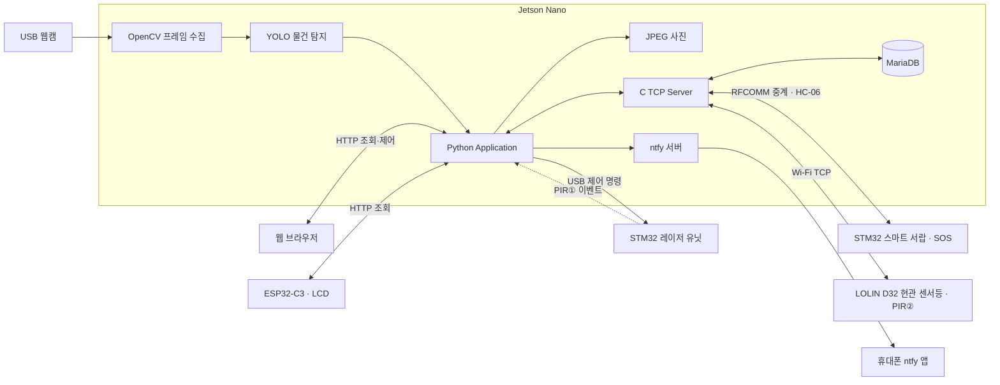

# Retrace

> 카메라가 물건의 마지막 모습을 기억하고, 다시 찾거나 외출 전에 챙길 수 있도록 돕는 스마트 공간 블랙박스

Retrace는 물건을 어디에 뒀는지 잊어버리는 일상의 불편을 줄이기 위한 IoT 시스템입니다. 카메라가 인식한 물건의 **마지막 목격 사진·시각·화면 좌표(Last Seen)**를 기록하고, 웹·레이저·스마트 서랍·LCD·휴대폰 알림으로 확인과 탐색을 돕습니다.

기록은 마지막으로 관찰했을 때의 정보입니다. 물건이 이동하거나 카메라 밖에 있으면 현재 위치와 다를 수 있으며, 동일 종류의 물건은 클래스별 최신 기록으로 관리합니다.

## 시스템 구성

| 구성 | 장치 | 역할 | 연결 |
|---|---|---|---|
| 허브 | Jetson Nano + USB 웹캠 | YOLO 인식, Last Seen, JPEG·MariaDB 저장, HTTP API·C TCP 서버 | USB / LAN |
| 레이저 안내 유닛 | STM32 NUCLEO-F411RE #1 + 서보 2개 + 레이저 + PIR① | 움직임 이벤트 전달, 각도 명령에 따른 레이저 안내 | USB Serial, 115200 |
| 스마트 서랍 | STM32 NUCLEO-F411RE #2 + HC-06 + PCA9685 | 서랍 6개 팝업·LED, SOS 버튼 | Bluetooth Classic / RFCOMM, UART 9600 |
| 현관 센서등 | LOLIN D32 + PIR② + LED | 자체 센서등, 현관 움직임 이벤트, 경고 점멸 | Wi-Fi TCP |
| 정보 표시 LCD | ESP32-C3 Super Mini + I2C 1602 LCD | 최근 목격 정보, 외출 준비물, 시각·날씨 표시 | Wi-Fi HTTP / I2C |
| 사용자 화면 | PC·휴대폰 웹 브라우저 | 물건 조회·사진 확대, 레이저·서랍 요청, 준비물 등록 | HTTP |
| 휴대폰 알림 | ntfy 서버·휴대폰 앱 | 외출 확인 및 SOS 알림 전달 | HTTP / 알림 채널 구독 |

## 시스템 구조



Python 애플리케이션은 Jetson에서 실행되며 인식·기록·좌표 변환·HTTP 요청·외출 재확인을 담당합니다. C TCP 서버는 DB 요청과 서랍·현관 노드의 메시지를 중계합니다. 레이저 제어는 Python에서 STM32로 직접 전달합니다. LCD는 정보를 조회하고 표시하며 장치를 제어하지 않습니다.

## 핵심 동작

### 물건 관찰·기록

PIR①의 움직임 이벤트를 받으면 카메라 영상에서 물건 탐지를 시작합니다. 안정적으로 인식되고 저장 조건을 충족한 물건의 사진과 정보를 갱신합니다. 사진은 JPEG 파일, 종류·좌표·시각·사진 경로는 MariaDB에 저장합니다. 새 관측이 없거나 저장하지 못하면 기존 기록을 유지합니다.

모델은 COCO 기본 80개 클래스와 추가 학습한 `car_key`·`wallet`·`earphones`를 함께 인식합니다. 사람(`person`)은 탐지할 수 있지만 물건 Last Seen 저장 대상에서는 제외합니다. 세부 조건은 [추론·기록 정책](docs/inference_policy.md)을 참고합니다.

### 물건 찾기·안내

웹에서 물건을 선택하면 마지막 사진과 시각을 확인할 수 있습니다. 레이저 안내 요청 시 저장된 화면 좌표를 보정된 서보 각도로 변환해 USB로 STM32에 전달합니다. 카메라와 레이저의 설치 위치·관측 평면이 바뀌면 보정도 다시 해야 합니다.

스마트 서랍은 웹에서 물건을 서랍에 등록하고 해당 서랍 열기를 요청하는 방식입니다. PCA9685로 해당 서보를 구동하고 LED로 번호를 표시합니다. 복귀는 서보 팔의 복귀이며 서랍 자동 닫힘은 아닙니다. LED는 닫힘 센서 없이 10초 타이머로 소등합니다. 수동 서랍 등록 정보는 카메라 기록과 별도로 관리합니다.

### 현관 외출 확인·휴대폰 찾기

PIR②가 움직임을 감지하면, 웹에서 등록한 준비물이 **현재 카메라 영상에 남아 있는지 약 3초간 재확인**합니다. 반복해서 확인된 물건이 있으면 이름을 넣은 준비물 알림과 현관등 경고 명령을 보냅니다. 책상 카메라가 현관을 관찰하는 구조는 아닙니다.

서랍의 SOS 버튼은 별도의 휴대폰 찾기 알림을 전송합니다. 메시지는 Jetson의 ntfy 서버를 거쳐 휴대폰 ntfy 앱으로 전달하며, 알림음 반복·음성 안내는 휴대폰 앱과 자동화 설정에 따릅니다.

### LCD 정보 표시

ESP32-C3는 Wi-Fi로 Jetson의 HTTP API를 읽고 I2C 1602 LCD에 표시합니다.

- 마지막 목격 정보: **10초마다 조회**, 사진·시각이 있는 최근 물건 최대 3개 표시.
- 외출 준비물: 웹에서 저장한 같은 목록을 **15초마다 조회**. 기본 오전 07:00~08:00에 표시.
- 화면 전환: 기본 **5초마다 순환**. 새 목격 기록은 5초간 우선 표시.
- 시각·날씨: 한국 시간과 Open-Meteo 예보 표시, 날씨는 10분마다 조회.
- 통신 실패: 이전 값을 유지하되 캐시·오프라인 상태 표시. 일반 1602 LCD에는 영문 이름 사용.

조회 주기는 DB에 기록하는 주기와 다릅니다. 핀·설정은 [LCD 안내](esp32/preparation_display/README.md)와 [핀맵](docs/pinmap.md)을 참고합니다.

## 사용 기술

- Jetson Nano / Linux, Python, Ultralytics YOLO, OpenCV
- C TCP 서버, MariaDB Connector/C, libjpeg
- STM32 NUCLEO-F411RE ×2, STM32CubeMX / HAL / CMake
- LOLIN D32·ESP32-C3 Super Mini, Arduino / PlatformIO
- USB Serial, Bluetooth Classic / RFCOMM, Wi-Fi TCP / HTTP, I2C
- HTML / CSS / JavaScript, ntfy, Open-Meteo

## 프로젝트 구조

```text
Retrace-Project/
├─ stm32/
│  ├─ main_unit/                # 레이저·Pan/Tilt·PIR①
│  └─ drawer/                   # PCA9685·서랍 LED·SOS
├─ esp32/
│  ├─ entrance_node/            # PIR②·센서등·Wi-Fi TCP
│  └─ preparation_display/      # ESP32-C3·LCD·Wi-Fi HTTP
├─ jetson_nano/
│  ├─ main.py                   # Python 애플리케이션 진입점
│  ├─ vision/                   # 탐지·안정화·좌표 변환·HTTP·외출 재확인
│  ├─ record/                   # Last Seen·외출 목록·수동 서랍 등록
│  ├─ communication/            # USB·TCP 이벤트·ntfy
│  ├─ client/                   # TCP ↔ HC-06 RFCOMM 중계
│  ├─ server_jetson/            # C TCP 서버·MariaDB·JPEG 검증
│  ├─ calibration/             # 설치 환경의 레이저 보정 파일
│  └─ models/yolo/              # 83개 클래스 모델
├─ web/                         # 조회·제어·준비물 등록 화면
└─ docs/                        # 핀맵·프로토콜·환경·검증 문서
```

## 문서

- [보드 핀맵·구동 값](docs/pinmap.md)
- [통신 프로토콜·HTTP API](docs/protocol.md)
- [추론·기록·외출 재확인 정책](docs/inference_policy.md)
- [개발 환경과 버전](docs/environment.md)
- [장치·전체 연동 체크리스트](docs/classroom_test_checklist.md)
- [Jetson 서버·DB 실행](jetson_nano/server_jetson/README.md)
- [웹 실행·연동](web/README.md)
- [LCD 배선·표시·설정](esp32/preparation_display/README.md)
- [협업·Git 규칙](CONTRIBUTING.md)
